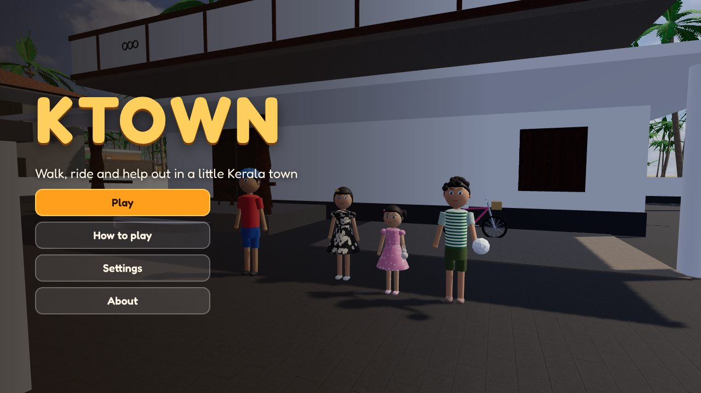
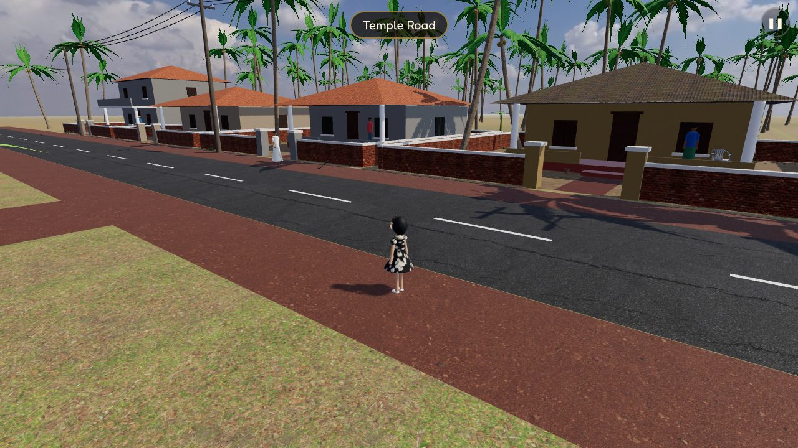
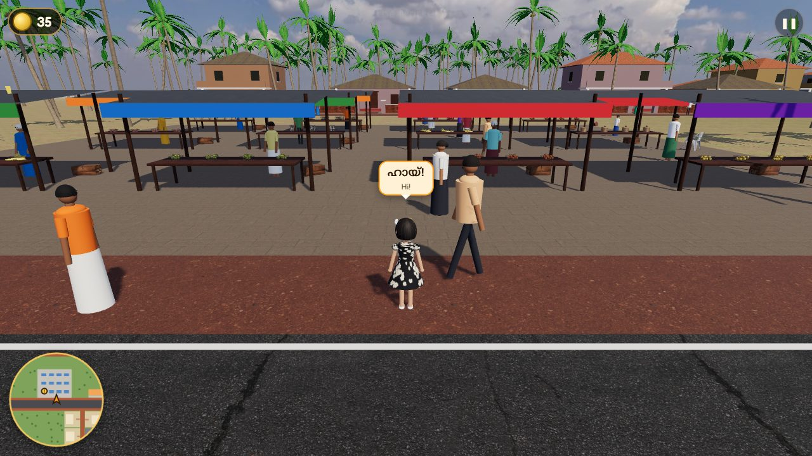
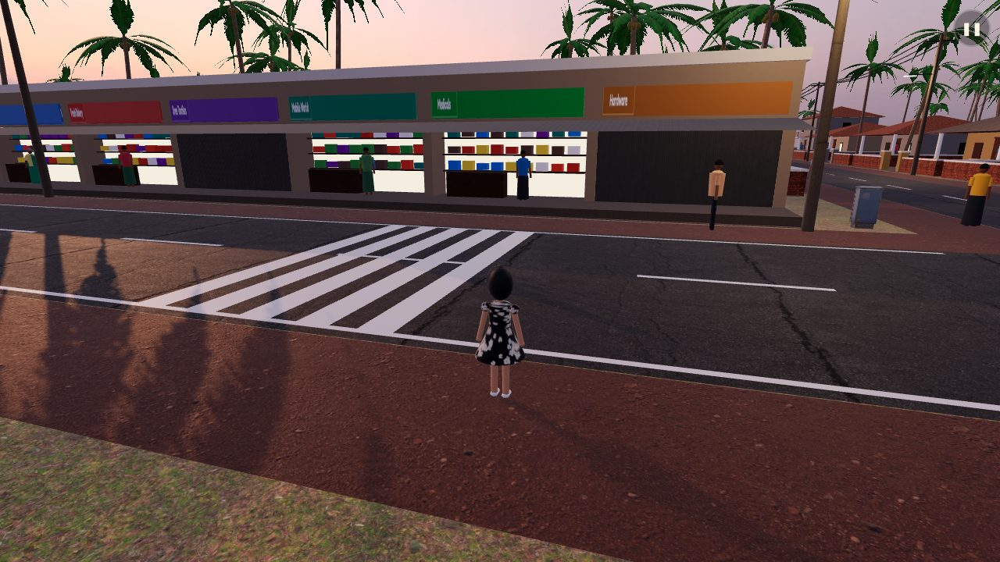

# KTOWN

Walk, ride and take autorickshaws around a little Kerala town with Inaara: the busy junction with its shops and
tea shop, the market under tin roofs, and lanes of colourful houses with clay-tile roofs, red laterite walls and
coconut palms everywhere.

**[▶ Play KTOWN](https://azeembukhariprivate.github.io/ktown/)**: free, in your web browser, on a computer or a phone.
Nothing to download.



KTOWN is being built in steps:

1. Done: **a town to walk in**: the junction, the shops, the market, the lanes, people about, day and evening.
2. Done (now): **getting about**: Inaara's home on Pond Lane, her own bicycle, autorickshaw rides, traffic on the
   roads (autorickshaws, scooters, motorbikes, cars, the town bus, a lorry), and the town's sounds.
3. Jobs from the people of the town, a map, and saved progress.
4. The rest of the town: paddy fields, the backwater with a boat, the temple and the beach.



## How to play

| | Keyboard and mouse | Phone or tablet | Game controller |
|---|---|---|---|
| Walk (or ride) | W A S D or the arrow keys | left thumb on the left side | left stick |
| Run (or pedal hard) | hold Shift | push the thumb all the way | right trigger |
| Jump | Space | Jump button | A |
| Get on or off the bicycle, take an autorickshaw | E (when it says so) | the button at the bottom | Y |
| Ring the bicycle bell | B | 🔔 | X |
| Look around | click, then move the mouse (Esc gives it back) | drag on the right side | right stick |
| Camera nearer or further | mouse wheel | | |
| Pause | P | ❚❚ | Start |

**Her bicycle** waits in her yard on Pond Lane. Ride it anywhere, and leave it where you like: a marker shows where
it is. **Autorickshaws** wait at the stand past the shops on the main road, or wave one down as it passes. Pick a place
and the driver takes you there; you can get off on the way too. The traffic keeps to the left and stops for people
and for Inaara. Bumping into anything only gives her a surprised face; nobody is ever hurt.

**Settings** has the time of day (day or evening, when the shops and street lights glow), the picture (automatic,
best, or faster for older phones, with less traffic), the camera's speed, sound on or off and how loud, and full
screen.

**Sounds** are real recordings: crows, a red-vented bulbul, parakeets and sparrows by day, cicadas from the Western
Ghats, crickets, frogs and a nightjar recorded in Kerala in the evening, the market's bustle, tea being poured at the
tea shop, children near School Lane, engines, horns, the bicycle bell and her footsteps.



## Keep it on your phone or computer

KTOWN works without the internet once it has been opened. To get an icon for it:

- **Android (Chrome):** open the game, tap the ⋮ menu, then **Add to Home screen** (or **Install app**).
- **iPhone or iPad (Safari):** open the game, tap the Share button, then **Add to Home Screen**.
- **Computer (Chrome or Edge):** open the game and click **Install** in the address bar.

Your settings are kept in your browser on that device. Nothing about you is sent anywhere.



## What it's made of

The houses, shops, palms, vehicles, people and Inaara's body and hair are made by the game's own code. Her face is
her own picture from her picture sheet, shared by her family. The ground, walls, roofs, skies and things lying about
(chairs, baskets, fruit, pots) are free (CC0) from [Poly Haven](https://polyhaven.com), and the sounds are free
recordings (public domain or CC0) from [Wikimedia Commons](https://commons.wikimedia.org); everyone who made them is
named in [THIRD-PARTY-NOTICES.txt](THIRD-PARTY-NOTICES.txt). The 3D drawing is done by [three.js](https://threejs.org).

## Build it yourself

You need [Node.js](https://nodejs.org) 22 or newer. There's nothing to build: the game is plain JavaScript files.

```
npm test               # movement, the town plan, the roads and traffic, every ride, the files
npm run test:browser   # plays it in Chromium (needs Playwright); screenshots in screenshots/
npm run serve          # then open http://localhost:8080/
```

Getting new textures, skies or models from Poly Haven, or sounds from Wikimedia Commons: run the **Fetch free
assets** workflow on GitHub (Poly Haven names, or `search:...` / `get:File:...` for sounds), download the `picked.zip`
it makes, then `python3 tools/prepare_assets.py <folder>` (pictures and models) or `python3 tools/prepare_sounds.py
<folder>` (sounds) makes them small and records them in `assets/SOURCES.json`; `python3 tools/write_notices.py`
names their makers, and `node tools/list_files.mjs` adds them to the offline copy.

## Licence

MIT. Made by Azeem, with Claude and ♥. Part of the KUDU family of free apps.
